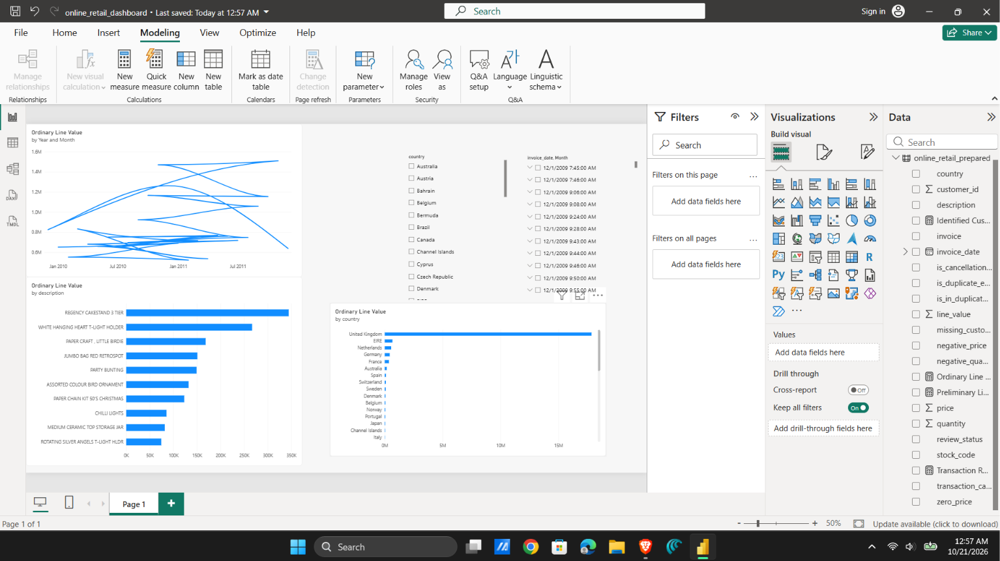
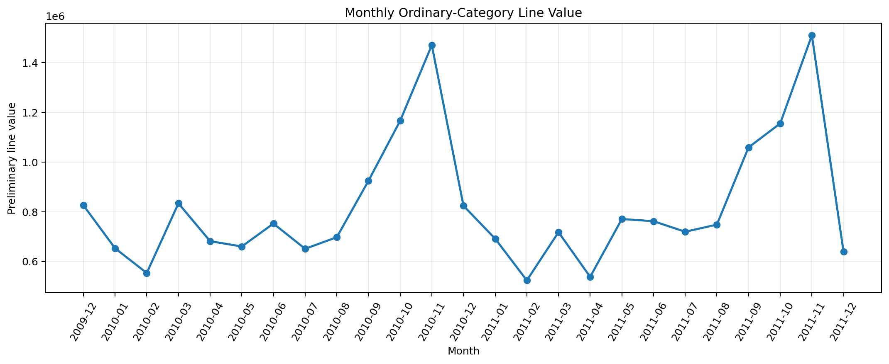
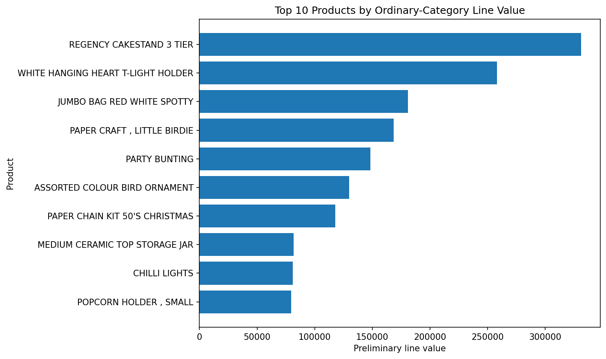

# UK Online Retail Revenue, Customer Value, and Product Performance Analysis

An end-to-end data analytics project investigating transaction patterns, product performance, customer value, country-level sales, and data-quality issues in the UCI Online Retail II dataset.



## Project Overview

Retail transaction data can help businesses understand which products generate the most recorded transaction value, how activity changes over time, which identified customers contribute the most, and how recorded value differs by country.

This project uses Python, pandas, SQLite, SQL, and Power BI to prepare and investigate retail transaction data. It also documents important data-quality limitations so that analytical results are not mistaken for audited financial figures.

## Business Questions

- How does ordinary-category line value change over time?
- Which products have the highest recorded line value?
- Which products have the highest recorded sales quantities?
- Which identified customers contribute the highest recorded transaction value?
- How does recorded transaction value vary by country?
- What data-quality issues should be considered before drawing business conclusions?

## Dataset

**Dataset:** Online Retail II  
**Source:** UCI Machine Learning Repository  
**Dataset page:** https://archive.ics.uci.edu/dataset/502/online+retail  
**License:** CC BY 4.0  
**Original source period:** December 2009 to December 2011

The original workbook contains two worksheets and a combined 1,067,371 source rows.

The worksheets share records in the December 1–9, 2010 date window. The preparation workflow checks the overlapping records and excludes the repeated window from the second worksheet to avoid counting those source records twice.

The final prepared dataset contains **1,044,848 rows and 18 columns**.

## Tools and Technologies

| Tool | Purpose |
|---|---|
| Python | Data preparation and exploratory analysis |
| pandas and NumPy | Data cleaning, transformation, and validation |
| Matplotlib | Data visualization |
| SQLite | Local analytical database and SQL validation |
| SQL | Aggregation and business-question analysis |
| Power BI Desktop | Interactive dashboard |
| Git and GitHub | Version control and project documentation |

## Data Preparation

The preparation workflow includes:

1. Loading both source worksheets.
2. Standardizing column names and data types.
3. Investigating and correcting the overlapping source date window.
4. Creating `line_value` using quantity multiplied by price.
5. Flagging cancellation-style invoice IDs, missing customer IDs, negative quantities, zero prices, negative prices, and duplicate occurrences.
6. Assigning transaction categories for analysis.
7. Exporting the prepared dataset to CSV.
8. Loading the prepared CSV into SQLite.
9. Comparing the CSV and SQLite row counts.

The latest reported validation confirmed 1,044,848 rows in both the prepared CSV and the SQLite database.

The latest reported transaction-category counts were:

| Transaction category | Rows |
|---|---:|
| Ordinary or other transactions | 1,022,284 |
| Cancellation-style invoices | 19,165 |
| Negative quantity outside a C-style invoice | 3,393 |
| Bad-debt adjustment | 6 |
| **Total** | **1,044,848** |

These categories are analytical groupings, not a formal accounting classification.

## Data Quality and Limitations

The source data contains missing customer identifiers, missing product descriptions, repeated rows, cancellation-style invoice IDs, negative quantities, zero prices, negative prices, and unusual transaction values.

These conditions are investigated rather than automatically assumed to be errors. A repeated row is not necessarily invalid, and a cancellation-style invoice does not by itself establish the full financial treatment of a transaction.

The `line_value` field is calculated as:

`quantity × price`

It is a **preliminary transaction-value measure**, not audited revenue, cash collected, or profit.

Customer rankings represent recorded transaction value, not customer profitability. Customer-level analysis may exclude transactions with missing customer IDs when a reliable customer identity is necessary.

Product rankings may exclude service-related or non-retail stock codes where the analysis explicitly documents that filter.

## Exploratory Analysis

The Python analysis includes:

- Monthly ordinary-category line-value trends.
- Product comparisons by recorded line value.
- Product comparisons by total quantity.
- Country-level transaction-value comparisons.
- Customer-value analysis.
- Data-quality investigation.

### Monthly line value



This chart explores how ordinary-category line value varies by month. It should be interpreted using the documented transaction filters and date coverage.

### Top products



This chart compares retail stock codes by recorded line value under the filters applied in the exploratory notebook.

## Power BI Dashboard

The Power BI dashboard provides a visual view of:

- Monthly ordinary-category line value.
- Top products by recorded line value.
- Country-level transaction value.
- Country and date filtering.

The dashboard is an exploratory reporting tool. Metrics should be interpreted alongside the project's documented definitions and limitations.

**Dashboard preview:** [Open the dashboard image](images/powerbi_dashboard.png)

**Power BI file:** [Open the PBIX file in the repository](powerbi/online_retail_dashboard.pbix)

The PBIX file requires Microsoft Power BI Desktop. Refreshing the report may require configuring the source path to the locally generated prepared CSV.

## SQL Analysis

SQL scripts are maintained in the `sql/` directory:

- [`01_data_validation.sql`](sql/01_data_validation.sql)
- [`02_business_analysis.sql`](sql/02_business_analysis.sql)

The queries support data validation and analysis of monthly trends, products, customers, and countries. The SQLite database is generated locally from the prepared CSV.

## Project Structure

```text
online-retail-analytics/
├── notebooks/
│   ├── 02_data_cleaning.ipynb
│   ├── 03_sql_analysis.ipynb
│   └── 04_exploratory_analysis.ipynb
├── sql/
│   ├── 01_data_validation.sql
│   └── 02_business_analysis.sql
├── images/
│   ├── monthly_line_value.png
│   ├── top_products.png
│   └── powerbi_dashboard.png
├── powerbi/
│   └── online_retail_dashboard.pbix
├── data/
│   └── processed/
│       ├── online_retail_prepared.csv  # Generated locally; not tracked
│       └── online_retail.db            # Generated locally; not tracked
├── project_notes.md
├── requirements.txt
├── .gitignore
└── README.md
```

The raw workbook and generated data files are local working files and are not intended to be committed to GitHub. The notebooks, SQL scripts, dashboard, images, and documentation provide the project workflow and portfolio artifacts.

## How to Reproduce the Analysis

### 1. Clone the repository

```bash
git clone https://github.com/codesmith-pixel/online-retail-analytics.git
cd online-retail-analytics
```

### 2. Install dependencies

Install Python and Jupyter Notebook, then run:

```bash
pip install -r requirements.txt
```

### 3. Download the dataset

Download Online Retail II from the [UCI dataset page](https://archive.ics.uci.edu/dataset/502/online+retail).

Place the workbook at:

```text
data/online_retail_II.xlsx
```

### 4. Prepare the data

Open and run `notebooks/02_data_cleaning.ipynb` in order. Review the outputs and save the prepared CSV to:

```text
data/processed/online_retail_prepared.csv
```

### 5. Run the SQL analysis

Follow `notebooks/03_sql_analysis.ipynb` and the SQL scripts in `sql/`. Ensure the SQLite database is generated from the latest prepared CSV before validating results.

### 6. Run the exploratory analysis

Open `notebooks/04_exploratory_analysis.ipynb` and run the cells in order.

### 7. Open the Power BI dashboard

Open `powerbi/online_retail_dashboard.pbix` in Power BI Desktop. If the local data source cannot be found, update the source path to the prepared CSV and refresh the report.

## Analytical Recommendations

The analysis can help identify products, periods, countries, and customer groups that merit further investigation.

Potential follow-up actions include reviewing inventory for consistently high-performing products, examining cancellation-related records, and investigating purchasing patterns among identified repeat customers.

These are analytical recommendations, not proven business outcomes. The project does not measure the effect of an implemented business intervention.

## Limitations

- The data represents one retailer and may not generalize to other businesses.
- Missing customer IDs limit customer-level analysis.
- Cancellation-style invoices and negative quantities require careful interpretation.
- Repeated rows are not automatically invalid transactions.
- Line value is not equivalent to audited revenue or profit.
- The analysis describes historical data and does not prove future performance.
- The results depend on the documented filters, data-preparation decisions, and metric definitions.

## Author

Data analytics portfolio project demonstrating data cleaning, exploratory analysis, SQL validation, visualization, and business-oriented reporting.

## Dataset Citation

Chen, D. (2012). *Online Retail II* [Dataset]. UCI Machine Learning Repository. https://doi.org/10.24432/C5CG6D

This dataset is used under the CC BY 4.0 license.
